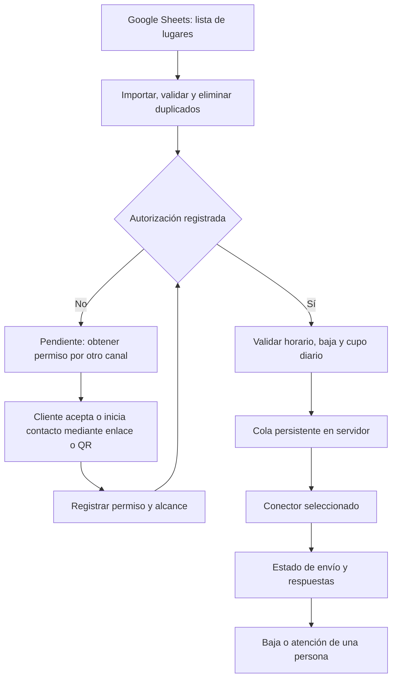

**Plan de automatización de WhatsApp para Aquatech**

Preparado el 16 de octubre de 2026. Este documento conserva el análisis y el plan inicial.

Actualización de implementación: ya existe un MVP en TypeScript con importación, cola persistente, API administrativa, simulación y conector Baileys. Para este volumen se eligió SQLite en lugar de PostgreSQL. La cuenta no está vinculada y los envíos reales siguen deshabilitados. Las instrucciones y los límites de la implementación están en [README.md](README.md).

El caso confirmado es una lista de lugares en Google Sheets, con contactos nuevos que no dieron autorización previa. Se busca enviar entre 15 y 20 mensajes diarios, de 08:00 a 20:00, desde un servidor y sin pagar la API de Meta. Falta definir los días de actividad y si el número actual es indispensable para la empresa.

La conclusión es que se puede construir un sistema sin cargos de la API de Meta usando conectores no oficiales, pero no se puede garantizar que no suspendan la cuenta. La condición Business no elimina ese riesgo. Para este caso, recomiendo preparar la lista y obtener autorización antes de activar mensajes automáticos por WhatsApp. El volumen reducido no convierte una lista de prospectos en una lista autorizada.

La política vigente exige que el destinatario haya facilitado su número y aceptado recibir comunicaciones. También exige respetar las bajas. Que un negocio publique su teléfono no demuestra ese permiso. Escribir manualmente tampoco elimina este requisito. [Política de mensajería de WhatsApp Business](https://whatsappbusiness.com/policy/).

**Alternativas y decisión**

| Alternativa | Pago a Meta | Alcance | Evaluación para este caso |
| --- | --- | --- | --- |
| Herramientas de la app Business | Automatizaciones básicas sin contratar la API | Bienvenida y ausencia; las respuestas rápidas requieren intervención | Útil para atención básica; no resuelve por sí sola el envío desde Sheets en un servidor |
| Baileys en servidor propio | Sin cargos de la API oficial | Conector de WhatsApp Web basado en WebSockets | Viable técnicamente para un prototipo; conexión no oficial y riesgo de suspensión |
| whatsapp-web.js en servidor propio | Sin cargos de la API oficial | Automatización de WhatsApp Web con navegador administrado por Puppeteer | Alternativa técnica; agrega un navegador y tampoco garantiza evitar bloqueos |
| Evolution API, conexión Baileys | Sin cargos de la API oficial en esa modalidad | API REST e integraciones | Puede ahorrar integración, pero agrega componentes y conserva el riesgo del conector |
| Cloud API oficial, directa | Tarifas y condiciones vigentes de Meta | Automatización mediante API soportada | Preferible para continuidad empresarial; no cumple una exigencia de costo cero garantizado |
| Telegram Bot API | Sin pago a Meta; modalidad gratuita con límites propios | Avisos a usuarios que iniciaron el bot | Alternativa si los clientes aceptan usar Telegram; no envía a WhatsApp |

Fuentes de la comparación: [herramientas de la app](https://whatsappbusiness.com/products/business-app-features/), [Baileys](https://github.com/WhiskeySockets/Baileys), [whatsapp-web.js](https://docs.wwebjs.dev/), [Evolution API](https://github.com/evolution-foundation/evolution-api), [tarifas de WhatsApp](https://whatsappbusiness.com/products/platform-pricing/), [límites gratuitos de Telegram](https://core.telegram.org/bots/faq) e [inicio de conversaciones con bots de Telegram](https://core.telegram.org/bots).

Baileys declara que no es un proyecto autorizado por WhatsApp y desaconseja usos masivos o automatizados. whatsapp-web.js también advierte que no garantiza evitar bloqueos. Evolution permite elegir entre Baileys y Cloud API: usar la primera no la convierte en una integración oficial; usar la segunda no elimina las tarifas. Antes de elegir Evolution habría que revisar la licencia de la versión concreta.

Sobre Cloud API: la página comercial consultada describe respuestas de servicio gratuitas dentro de la ventana de atención. No pude contrastar su vigencia con la documentación detallada de Meta, que devolvió un error de acceso. Por eso este plan no promete gratuidad, una cuota gratuita ni un precio exacto para esa opción. La ventana de 24 horas es una regla de mensajería y no debe interpretarse como garantía de costo cero. La contratación directa evita el abono de un intermediario, pero no las tarifas aplicables de Meta.

**Flujo propuesto para tu lista**



Primero se importa toda la planilla como pendiente, sin mensajes de WhatsApp. La autorización se puede captar en una visita, una llamada o un correo adecuado, o mediante un formulario con enlace a WhatsApp. Cada canal requiere respetar sus reglas y las preferencias del destinatario. No se enviará automáticamente un primer WhatsApp para pedir permiso a toda la lista.

Ejemplo de aceptación a registrar: “Quiero recibir por WhatsApp información comercial de Aquatech. Puedo darme de baja cuando quiera”. El alcance debe corresponder al mensaje futuro: una consulta puntual no habilita campañas comerciales indefinidas.

**Datos y conexión con Google Sheets**

La planilla contendría `contact_id`, `lugar`, `telefono`, `pais`, `origen_contacto`, `consentimiento_estado`, `consentimiento_fecha`, `consentimiento_alcance`, `consentimiento_evidencia` y `fecha_programada`. No se usará el número de fila como identificador: ordenar la planilla no debe crear nuevos destinatarios.

El servidor leerá la planilla cada 10 minutos mediante una cuenta de servicio con acceso de lector al archivo específico y permiso `spreadsheets.readonly`. Ese permiso alcanza los archivos accesibles a esa identidad; no se limita a una pestaña. Se utilizará una planilla dedicada y no se publicará como CSV abierto. Los estados reales de envíos y bajas se guardarán en la base del servidor para que editar o reimportar una fila no borre el historial. [Permisos de Sheets](https://developers.google.com/workspace/sheets/api/scopes) y [autenticación de servidor](https://developers.google.com/identity/protocols/oauth2/service-account).

La API de Sheets no tiene costo adicional por uso dentro de sus condiciones y cuotas; para esta frecuencia bastan lecturas agrupadas. Si falla Google, se pausarán nuevos envíos hasta volver a validar los datos. [Cuotas y costos de Sheets API](https://developers.google.com/workspace/sheets/api/limits).

**Diseño del servidor y configuración prevista**

Propuesta técnica: Node.js con TypeScript, PostgreSQL y un único proceso de envío. La misma base guardará la cola; para este volumen no hace falta agregar Redis. El conector será reemplazable para poder pasar de un prototipo a la API oficial sin rehacer la importación ni las reglas.

Si se mantiene la restricción de no pagar a Meta, Baileys es un candidato para evaluar en un entorno de prueba por su [arquitectura sin navegador](https://baileys.wiki/). Esto es una elección técnica, no una afirmación de que sea más seguro frente a suspensiones. Para un número del que depende la empresa recomiendo herramientas admitidas por WhatsApp y evaluar Cloud API antes de vincular un conector no oficial. Un número de prueba sirve para aislar ensayos, no para continuar envíos después de una sanción.

Configuración conceptual; todavía no está implementada:

```yaml
modo: simulacion
envios_habilitados: false
zona_horaria: America/Argentina/Cordoba
horario_inicio: '08:00'
horario_fin_exclusivo: '20:00'
dias_activos: por_definir
maximo_avisos_proactivos_por_dia: 20
consentimiento_verificable_obligatorio: true
excluir_bajas: true
seguimientos_automaticos_sin_respuesta: false
pausar_si_falla_sincronizacion: true
pausar_si_sesion_desconectada: true
```

El máximo de 20 corresponde a tu necesidad comercial, no a un umbral publicado por WhatsApp. No se forzarán 15 envíos si hay menos contactos elegibles. Se programarán avisos durante el horario elegido; los vencidos no se acumularán en una ráfaga al reiniciar. Las respuestas solicitadas por clientes se gestionarán aparte, con límites para evitar bucles.

Antes de cada envío se volverá a verificar autorización, baja, horario y duplicados. La clave única combinará campaña, contacto y evento. El cupo diario se persistirá entre reinicios. Si un envío queda en estado incierto, no se repetirá a ciegas: pasará a revisión. Que la biblioteca acepte un mensaje no significa que el destinatario lo haya recibido o leído.

Ante “BAJA”, “no me escriban” o una solicitud equivalente, se cancelarán pendientes y se registrará la exclusión. También habrá un mecanismo para cargar bajas recibidas por otros canales. Se ofrecerá contacto con una persona y un botón administrativo de pausa general.

No hay una tasa universal de mensajes que garantice evitar sanciones. Los intervalos aleatorios, simular escritura o rotar IP y números no resuelven la falta de autorización. Los conectores no oficiales tampoco permiten conocer de forma fiable todos los reportes o bloqueos de destinatarios; las alertas se basarán en señales disponibles, bajas, fallas y revisión del operador.

**Etapas de implementación y validación**

1. Preparar la planilla y el proceso de autorización. Identificar días activos, país de los destinatarios y criticidad del número. Resultado: contactos clasificados y reglas comerciales definidas.
2. Implementar importación y simulación. Resultado: reporte de qué filas serían elegibles y por qué, sin conectar WhatsApp.
3. Implementar cola, programación, bajas y registro de resultados. Verificar duplicados, edición de filas, reinicio, horario límite y cancelación de pendientes.
4. Evaluar el conector con cuentas y destinatarios de prueba autorizados. Probar desconexión, recuperación de sesión y fallas de envío. Una prueba exitosa no certifica ausencia de riesgo futuro.
5. Preparar Docker Compose, acceso administrativo restringido, secretos fuera del repositorio y copias cifradas de base y sesión. Punto inicial de capacidad: VPS con 1 vCPU y 2 GB de RAM para texto y una sola cuenta; medir antes de producción.
6. Desplegar y activar únicamente destinatarios elegibles. Revisar resultados y bajas durante la primera semana. Ante restricción, detener envíos y usar el proceso oficial de revisión; mantener un canal alternativo de atención.

Estimación orientativa: 4–7 jornadas de desarrollo para un MVP sin panel visual complejo, después de definir acceso a Sheets y conector. La obtención del permiso de los contactos tiene un plazo independiente. Esta propuesta no incluye desarrollo ni despliegue ya realizados.

**Costos previstos**

Baileys tiene licencia MIT y whatsapp-web.js Apache 2.0; el software no exige contratar la API oficial. Persisten costos de servidor, respaldos, línea y mantenimiento. Como referencia verificable, DigitalOcean publica un VPS básico de 1 vCPU y 2 GiB a USD 12 mensuales, antes de adicionales e impuestos; si ya tenés servidor con capacidad disponible, se puede aprovechar. Es una referencia de presupuesto, no una compra realizada. [Precios del proveedor](https://www.digitalocean.com/pricing/droplets).

La primera versión usará textos y reglas, sin depender de un servicio de IA pago. Se reservará tiempo de mantenimiento porque los cambios de WhatsApp Web pueden romper los conectores. Si se elige Cloud API, se calculará su presupuesto con tarifas vigentes verificadas y un límite de gasto; queda fuera del escenario estricto de no pagar Meta.

Para tu situación actual, el primer entregable recomendable es Sheets → validación → registro de permisos → simulación. Después se puede habilitar el envío automático de hasta 20 avisos diarios a quienes aceptaron. Automatizar la prospección fría directamente por WhatsApp no cumple el objetivo de proteger la continuidad de la cuenta.
